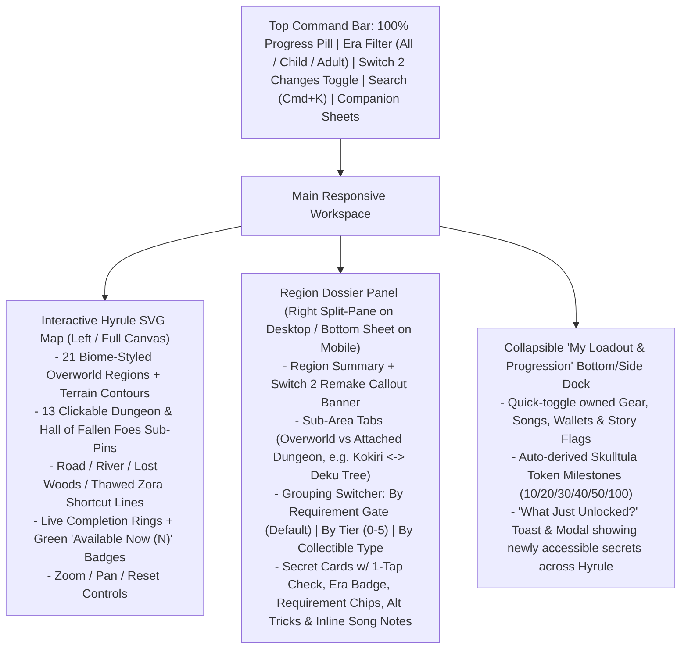

# Architecture Specification — Ocarina of Time (Switch 2 Remake) Interactive Map & Secrets PWA

## 1. Product Vision & Core UX Principles

The goal is the **fastest, clearest possible companion experience** for *The Legend of Zelda: Ocarina of Time (Nintendo Switch 2 Remake, Nov 2026)*:

1. **Spatial First (Click Any Region on Hyrule's Map):** An illustrated, topographic SVG map of Hyrule (`1000 × 700` coordinate space) where clicking any of the **21 Overworld Regions** or **13 Dungeons / Mini-Dungeons / Hall of Fallen Foes** immediately opens everything worth doing there—with zero page reloads or hunting through walls of prose.
2. **Requirement-First Categorization (Never Waste a Trip):** Inside every region, secrets are **separated and categorized by their exact gating requirements**:
   - **🟢 Ready to Grab Right Now** (no special gear needed, or 100% satisfied by your checked Loadout—including early alternate tricks like Child Cucco glides!).
   - **🔒 Locked Behind Specific Requirements** — cleanly sub-grouped by *what blocks them* (e.g., *Cross-Era Time-Travel Puzzle*, *Needs Bombs*, *Needs Boomerang*, *Needs Song of Storms*, *Needs Hookshot*, *Needs Adult's Wallet [500 Rupees]*, *Nighttime Only*).
3. **Switch 2 Remake Native:** Explicitly highlights **Switch 2 Exclusives & Changes** (`NEW IN SWITCH 2` / `UPDATED IN SWITCH 2` badges) so returning N64/3DS veterans never fall for removed Heart Pieces (Ice Cavern, old Stone of Agony grottos) or miss the 5th Bottle, Echo Gem, Great Fairy Rupee fees, and thawed Zora's Domain shortcut.
4. **100% Offline Static PWA (Firebase Hosting + GitHub Pages Ready):** Runs entirely client-side with zero backend dependencies, installs onto iOS/Android/Switch-side tablets or desktop, works offline on airplanes/couches, and deploys cleanly to **both** Firebase Hosting (`https://<project>.web.app`) and GitHub Pages (`https://<user>.github.io/<repo>/`).

---

## 2. Technical Stack

- **Build & Dev Tooling:** `Vite 6+` + `TypeScript 5.x` (`strict: true`)
- **UI Runtime:** `React 19` (lightweight functional components + React hooks; zero heavy component-library bloat)
- **Styling:** Modern Vanilla CSS + CSS Custom Properties (`modern-web-guidance` compliant: native `<dialog>` / Popover API, CSS Grid, Container Queries, `@starting-style` / View Transitions, `prefers-color-scheme` with "Sheikah Slate / Twilight Dark" default + "Hyrule Parchment Light" toggle)
- **Icons:** Inline crisp custom Zelda/UI SVG icons + `lucide-react`
- **PWA & Offline:** `vite-plugin-pwa` (Workbox `generateSW` precaching all JS/CSS/HTML/SVG/icons + `/data/*.json` baked into the bundle)
- **State & Persistence:** `localStorage` (`zelda-oot-sw2-progress-v1`) with versioned migration + **1-click JSON Export / Import** backup & restore
- **Verification & QA:**
  - `node data/validate-data.mjs` (canonical game data & count verification)
  - `Vitest` + `@testing-library/react` (unit tests for gating engine, milestone auto-derivation, requirement grouping, and data normalization)
  - `Playwright` (headless Chromium E2E verifying map interaction, region drawer requirement categorization, loadout unlock delta, search, mobile viewport, zero console errors, and service worker registration)

> **Mandatory Pre-Implementation Rule (`modern-web-guidance`):**  
> Before authoring HTML/CSS/UI components, UI workers MUST execute `pnpx modern-web-guidance@latest search "<query>"` (or `npx -y modern-web-guidance@latest search "<query>"`) for relevant patterns (`"light dismiss dialog"`, `"popover hint"`, `"dark mode theme"`, `"container queries"`, `"accessible tabs"`) and apply retrieved guidance.

---

## 3. Dual-Hosting Architecture (Firebase Hosting & GitHub Pages)

A common pitfall of SPAs/PWAs is hardcoding absolute root paths (`/`), which works on Firebase Hosting (`https://app.web.app/`) but breaks CSS, icons, and Service Workers on GitHub Pages (`https://user.github.io/Zelda/`).

### 3.1 Relative-Safe Build Contract
1. **`vite.config.ts`:** Set `base: './'` (or `process.env.VITE_BASE_PATH || './'`).
2. **PWA Manifest & `vite-plugin-pwa`:**
   - Use relative `start_url: './'`, `scope: './'`, and relative icon `src: 'icons/icon-192.png'` (no leading slash).
   - Register the service worker via `virtual:pwa-register` so Vite resolves the relative SW URL automatically in both root and subdirectory deployments.
3. **URL Deep-Linking via Hash State (`#region=kakariko-village&view=map`):**
   - Sync selected region, era lens, and active modal/sheet to `window.location.hash` rather than pathname pushState.
   - **Why:** Both GitHub Pages and Firebase Hosting resolve `#region=death-mountain-crater` with zero server-side rewrite rules required, AND bookmarking/sharing links works identically everywhere!

### 3.2 Ready-to-Use Hosting Configs Included in Repo Build
- **`firebase.json`:**
  ```json
  {
    "hosting": {
      "public": "dist",
      "ignore": ["firebase.json", "**/.*", "**/node_modules/**"],
      "headers": [
        {
          "source": "**/*.@(js|css|svg|png|webp|woff2)",
          "headers": [{ "key": "Cache-Control", "value": "public, max-age=31536000, immutable" }]
        },
        {
          "source": "sw.js",
          "headers": [{ "key": "Cache-Control", "value": "no-cache" }]
        }
      ]
    }
  }
  ```
- **`.github/workflows/deploy-pages.yml`:** GitHub Actions workflow running `npm ci`, `npm run validate:data`, `npm test`, `npm run build`, and `actions/deploy-pages@v4` on pushes to `main`.

---

## 4. Information Architecture & Screen Layout



### 4.1 Interactive Hyrule SVG Map (`src/components/map/`)
- **Coordinate System:** Uses the exact `mapCoords` (`x` in `0..1000`, `y` in `0..700`) and `biome` values in [`data/regions.json`](file:///Users/connor/Coding/Personal/Zelda/data/regions.json).
- **Visual Clarity:**
  - Stylized topographic Hyrule landmass with distinct biome regions: Kokiri/Lost Woods emerald canopy (SE), Zora sapphire river & fountain (E), Death Mountain volcanic caldera (NE), Castle Town & Hyrule Field golden plains (Center/N), Lake Hylia azure basin (S), Gerudo & Desert Colossus sandstone canyon/dunes (W/NW).
  - **Connection Paths:** Solid lines for walking roads/bridges, dashed cyan lines for Lost Woods / Zora underwater warp tunnels (with a tooltip noting Zora's Domain unfreezes post-Water Temple in Switch 2!).
  - **Region Node Anatomy:**
    - Region Name + Biome Icon
    - Progress Ring (`completed / total` secrets in region; turns Gold with a Triforce checkmark at 100%)
    - **Actionable Green Pill (`+3 Ready`)**: Count of uncollected secrets in that region that are **100% accessible right now** given the user's current Loadout & Era filter!
  - **Dungeon Sub-Badges:** Attached dungeons (`deku-tree`, `dodongos-cavern`, `water-temple`, `hall-of-fallen-foes`, etc.) render as distinct octagonal/crest pins tethered to their parent region and are also selectable inside their parent region's drawer header!
  - **Keyboard & Screen Reader Support:** Every region and dungeon node is a focusable `<g role="button" tabIndex={0}>` (or `<button>` overlay) with descriptive `aria-label` (e.g., `"Kakariko Village: 8 of 14 completed, 3 ready now"`).

### 4.2 Region Dossier & Requirement Categorization (`src/components/region/`)
When a user clicks **Hyrule Field**, **Kakariko Village**, **Death Mountain Crater**, etc.:
1. **Header & Switch 2 Remake Callout:**
   - Displays region title, biome badge, Child/Adult Skulltula & Heart Piece tallies (matching the Switch 2 in-game map counter!), and a highlighted **"Switch 2 Remake Changes"** alert box summarizing `switch2Highlights` for that region.
   - Quick-jump pills to any attached Dungeon/Mini-Dungeon (e.g., clicking *Kakariko Village* offers a 1-click tab for *Bottom of the Well (0/4)*).
2. **Categorized Secret Sections (Core Requirement!):**
   - **🟢 Ready Right Now (`available-now` + `available-via-alt`):**
     - Immediately actionable items sit at the very top—no scrolling past late-game blockers!
     - Items accessible via an early alternate method (`available-via-alt`) display an **Amber "Early Trick Available"** callout (e.g., *"Standard: Adult + Hookshot — Early Alt Ready Now: Child Cucco Glide!"*).
   - **🔒 Locked Behind Specific Requirements (`locked`):**
     - Grouped into clean, collapsible requirement headers with clear icons and item counts:
       - `⏳ Cross-Era Time-Travel Puzzles` (with Step 1 / Step 2 timeline badges!)
       - `🎵 Locked: Needs [Song Name]` (clicking the song chip reveals `Y → X → A → Y → X → A` inline!)
       - `💣 Locked: Needs [Specific Item / Gear]` (e.g., *Needs Bombs (2)*, *Needs Boomerang (3)*, *Needs Hookshot (4)*, *Needs Megaton Hammer (2)*)
       - `💰 Locked: Needs Adult's Wallet (500 Rupees)`
       - `🌙 Locked: Nighttime / Bottled Bugs`
     - Every requirement pill on a card is **color-coded**: Green (`✓ Owned`) vs Red/Amber (`✗ Missing — click to see how to get it!`). Clicking any missing requirement chip opens a mini popover explaining **exact instructions on where to get that item/song** (`requirements.json -> howToGet`) and a button to jump straight to *that* region on the map!
   - **✅ Completed (`completed`):** Collapsed/dimmed at the bottom so finished items never clutter active play.

### 4.3 Quick Loadout Dock & "What Just Unlocked?" Recommender (`src/components/loadout/`)
- Compact dock/drawer grouping gear into **Era (`Child` / `Adult` / `Time Travel`)**, **Child Tools**, **Adult Dungeon Gear**, **Ocarina Songs**, and **Wallets/Upgrades**.
- **Preset Story Checkpoints** for instant setup if starting mid-playthrough:
  - *"Fresh Start (Kokiri Forest)"*
  - *"After Dodongo's Cavern (Bombs Unlocked)"*
  - *"All 3 Spiritual Stones (Pre-Master Sword)"*
  - *"Fresh Adult Link + Hookshot"*
  - *"Post-Forest Temple (Time Travel + Hall of Fallen Foes Unlocked)"*
  - *"Post-Water Temple (Longshot + Zora's Domain Thawed)"*
  - *"Endgame Cleanup (All Gear)"*
- **Unlock Impact Toast:** Whenever toggling an item ON unlocks `N > 0` secrets across Hyrule, display a non-intrusive toast: `"Hookshot unlocked 18 new secrets across 10 regions — View List"`.

### 4.4 Quick-Reference Companion Modals (`src/components/sheets/`)
Accessible from the top navigation bar at any time:
1. **Ocarina Songbook & Custom Scarecrow Notepad:** All 13 songs with Switch 2 `Y / X / A / R / L` visual button badges + a field to record your personal 8-note Scarecrow's Song so you don't forget it 15 hours later as Adult Link!
2. **Quest Chains Tracker:** Interactive step-by-step checklists for the **12-Step Biggoron's Sword Quest** (highlighting the `4:00`, `2:30`, and `3:30` no-warp timers + Switch 2 thawed Zora's Domain shortcut!) and **Happy Mask Shop Sequence**.
3. **Switch 2 Remake Diff & Hall of Fallen Foes Guide:** Master cheat-sheet of all 2026 changes, all 5 Bottles, all 6 Great Fairy Rupee fees (`1,175 Rupees`), all 10 Magic Bean prices (`550 Rupees`), and Hall of Fallen Foes unlock instructions.
4. **Global Search (`Cmd+K` / `/`):** Instant fuzzy filter across all 232+ secrets, items, songs, and regions.

---

## 5. Swarm-Safe Directory & Module Ownership Plan

To guarantee **zero merge conflicts** and **first-try success** when built by a parallel Antigravity Swarm, enforce strict file boundaries:

```text
/Users/connor/Coding/Personal/Zelda/
├── data/                              # [READ-ONLY SOURCE OF TRUTH — ALREADY POPULATED & VALIDATED]
│   ├── metadata.json
│   ├── requirements.json
│   ├── regions.json
│   ├── heart-pieces.json
│   ├── gold-skulltulas.json
│   ├── upgrades-and-bottles.json
│   ├── songs-and-quests.json
│   └── validate-data.mjs
├── docs/                              # [ARCHITECTURE, SCHEMA, BOOKLET & PROMPT]
├── public/
│   └── icons/                         # PWA icons (SVG + 192x192 & 512x512 PNGs)
├── src/
│   ├── types/
│   │   └── zelda.ts                   # [Owner: foundation] Canonical TypeScript interfaces
│   ├── data/
│   │   └── index.ts                   # [Owner: foundation] Imports /data/*.json -> UnifiedSecret[], RegionLookup, RequirementLookup
│   ├── lib/
│   │   ├── gating.ts                  # [Owner: foundation] Accessibility engine, blocker grouping, unlock delta calculator
│   │   ├── storage.ts                 # [Owner: foundation] localStorage hook, auto-milestone sync, JSON export/import, hash state
│   │   └── gating.test.ts             # [Owner: foundation] Unit tests for gating, milestones, & all 232+ normalized items
│   ├── styles/
│   │   └── tokens.css                 # [Owner: foundation] Design tokens, dark/parchment themes, typography, animations
│   ├── components/
│   │   ├── map/                       # [Owner: map-ui] HyruleMapCanvas.tsx, RegionNode.tsx, DungeonPin.tsx, MapLegend.tsx, map.css
│   │   ├── region/                    # [Owner: drawer-ui] RegionDrawer.tsx, SecretCard.tsx, RequirementPill.tsx, SongPopover.tsx, region.css
│   │   └── sheets/                    # [Owner: loadout-sheets] LoadoutDock.tsx, StoryPresets.tsx, OcarinaModal.tsx, QuestsModal.tsx, SearchModal.tsx, Switch2DiffModal.tsx, sheets.css
│   ├── App.tsx                        # [Owner: integrator / coordinator-assigned] Top shell wiring Map + Drawer + Loadout + Modals
│   └── main.tsx                       # [Owner: foundation / pwa-deploy] Entry point + PWA service worker registration
├── e2e/
│   └── app.spec.ts                    # [Owner: qa-verifier] Playwright E2E suite
├── firebase.json                      # [Owner: pwa-deploy] Firebase Hosting config
├── .github/workflows/deploy-pages.yml # [Owner: pwa-deploy] GitHub Pages CI/CD workflow
├── vite.config.ts                     # [Owner: pwa-deploy] Vite + vite-plugin-pwa + relative base './'
└── package.json                       # [Owner: foundation] Scripts: dev, build, preview, test, test:e2e, validate:data
```

---

## 6. Definition of Done & Automated Quality Gates

The build is ONLY complete when **every single gate passes with exit code 0**:
1. `npm run validate:data` (`node data/validate-data.mjs`) -> Confirms all 36 Heart Pieces, 100 Gold Skulltulas, 5 Bottles, 6 Great Fairies, 13 Songs, 10 Magic Beans, and 34 Regions remain intact.
2. `npm run typecheck` (`tsc --noEmit`) -> Zero TypeScript errors.
3. `npm test` (`vitest run`) -> Unit tests verify:
   - Total normalized collectible counts match `metadata.json`.
   - Checking 10 / 20 / 30 / 50 / 100 Gold Skulltulas auto-satisfies `tokens-10`..`tokens-100`.
   - `hp-05`, `hp-06`, and `gs-010` categorize as Cross-Era puzzles until `time-travel` + prerequisites are met.
   - `available-via-alt` triggers properly (e.g., `hp-33` Gerudo Valley Gorge Chest is ready for Child Link via immediate Cucco glide AND ready for Adult Link with Hookshot).
   - Toggling `hookshot` computes accurate newly-unlocked secret deltas.
4. `npm run build` -> Produces clean static `dist/` with relative asset paths (`./assets/...`), `manifest.webmanifest`, `sw.js`, and precache manifest.
5. `npm run test:e2e` (Playwright against `vite preview` served under a subpath `/Zelda/` to prove GitHub Pages compatibility AND `/` for Firebase Hosting!) -> Verifies:
   - Interactive SVG map renders all 21 Overworld regions and 13 Dungeon/Special pins with zero overlapping/clipped labels.
   - Clicking a region opens the Region Dossier and displays **Ready Right Now** items separated from **Locked Behind Specific Requirements** categories.
   - Checking off a secret updates regional & global counters and persists across page reload.
   - Toggling an item in Loadout dynamically moves locked secrets into **Ready Right Now**.
   - Mobile (`390×844`) and Desktop (`1440×900`) viewports render cleanly with zero horizontal overflow and zero console/page errors.
